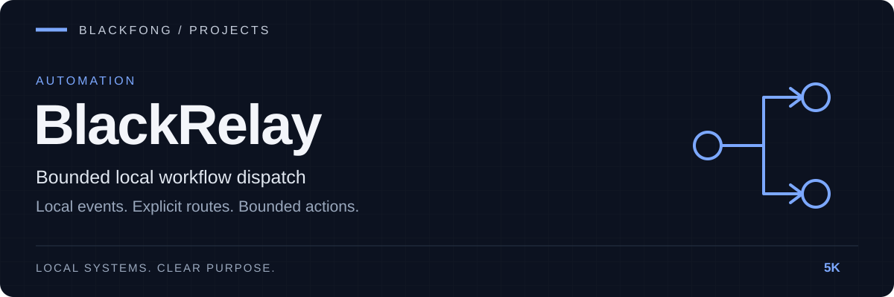

**Bounded local workflow dispatch.**

[Architecture](docs/blackrelay-concept1.md) · [Integration contract](docs/obeos-integration-contract.md)

---

# BlackRelay

| Trigger | Route | Stage |
|---|---|---|
| Local file and event activity | Bounded adapters and explicit actions | Architecture and MVP scaffold |

BlackRelay is a local-first workflow dispatcher for the Blackfong/OBEOS ecosystem. It reacts to local file or event activity and routes actions through bounded adapters.

Current status: planned / MVP scaffold.

BlackBus moves events. BlackRelay reacts to events.

Canonical ownership: this repository is the source of truth. OBEOS consumes BlackRelay as a pinned component/submodule rather than maintaining a second editable copy.

See `docs/blackrelay-concept1.md` for the current architecture and MVP definition.
